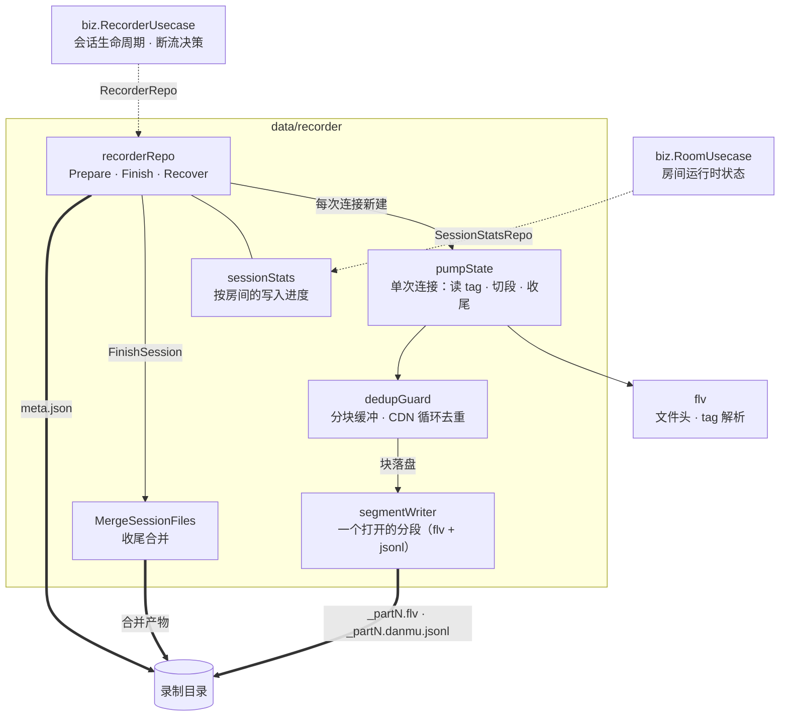

# recorder

`data/recorder`：录制会话在磁盘上的**全部**形状——目录布局、FLV 落盘与切段、弹幕 JSONL、meta.json 簿记、收尾合并，以及运行期的写入进度。实现 `biz.RecorderRepo`（内嵌 `biz.SessionStatsRepo`）。

决策不在这里：何时开播、何时开录、断流后是否重连，全部由 `biz.RecorderUsecase` 决定；本包只把已经决定要录的字节写对。

## 架构



点线是缝（接口与实现），实线是包内调用，粗线是落盘。

图里要紧的是**三种生命周期各归其位**：`recorderRepo` 是进程级的（录制根目录 + 按房间的进度表），一次 Session 由 `PrepareSession` 开、`FinishSession` 收，而 `pumpState` 随每次 `PumpSession` 调用创建销毁。断流重连会多次调用 `PumpSession`，所以凡是"重连后还得记得"的东西都不能放进 `pumpState`。

`dedupGuard` 卡在读取与落盘之间，使写入变成**延迟一个块**：tag 先入块缓冲，块关闭时才判重并落盘。这一层是 CDN 循环吐流唯一的观测点（字节一直在涨，健康巡检看不见），代价是切段判定与流结束都要先处理在途块。

## 文件

| 文件 | 内容 |
|---|---|
| `recorder.go` | `recorderRepo`：`PrepareSession` / `FinishSession` / `RecoverPending` 三个生命周期动作；`finalizeSession` 收尾合并与 `archiveMergedSession`——同一场直播关闭录制后再开启时，把上一轮合并产物改名为历史分段，使续录是追加而不是覆盖 |
| `paths.go` | `sessionLayout`（会话目录 + 文件名前缀）：会话内所有文件名都由这两者派生；`sessionPaths` 布局推导、`sessionLayoutFromMetaPath` 从 meta 路径反解、`sanitizeSegment` 清洗、`nextPartNumber` 扫目录续号 |
| `meta.go` | meta.json 的 PO（`sessionMeta` / `segmentMeta` / `qualityMeta` / `errorMeta`）与读写：`saveMeta` 原子替换、`updateMeta` 读改写、`appendSegmentMeta` / `finishSegmentMeta` / `appendMetaError` |
| `recorder_pump.go` | `PumpSession` 拉流循环（select：ctx / tag / 事件 / 速度采样 / 健康巡检）与 `pumpState`——单次连接的会话态，`handleTag` 的落盘与切段顺序 |
| `segment.go` | `segmentWriter`（一个打开的分段：视频与弹幕两个句柄）、`initTags`（初始化标签缓存与序列头变化检测）、`OpenSegment` 与 `writePreamble`、切分判定 `shouldSplit` / `splitBySize` / `splitByDuration`、弹幕 PO `danmakuEventPO` |
| `dedup.go` | `dedupGuard`：分块缓冲、FNV-1a 块指纹（不含时间戳，容忍循环重放重写时间戳）、16 块滑动窗口、连续 10 次重复判定为循环吐流 |
| `pump_monitor.go` | `speedTracker`（单次连接的下载速度采样）与 `healthMonitor`（连续无新数据落盘的巡检） |
| `stats.go` | `statsStore` / `sessionStats`：按房间的写入进度（当前文件、已写字节、下载速度），即 `SessionStatsRepo` 的实现 |
| `merge.go` | `MergeSessionFiles`：分段 FLV 合并（第 2 段起跳文件头、所有 onMetaData 一律跳过、段首重新注入的序列头时间戳平移到合并边界）与分段弹幕按 part 顺序拼接 |

## 三种生命周期

| 生命周期 | 载体 | 活多久 |
|---|---|---|
| 进程 | `recorderRepo`（`recordRoot`、`statsStore`） | 从启动到停机 |
| Session（一次连续直播） | `sessionStats` + 会话目录与 meta.json | `PrepareSession` → `FinishSession`，跨其内所有断流重连 |
| 单次连接（一次 `PumpSession`） | `pumpState` + `speedTracker` | 随调用创建销毁 |

判据只有一条：**重连后还成立的状态上移，只对本次连接成立的留下**。写入进度（`sessionStats`，按房间 ID 索引）必须在 Session 内持久——重连后进度条不能归零，所以它挂在 repo 上、只在 `PrepareSession` 时重置一次。段边界、去重窗口、速度采样、健康巡检计数则全是单次连接的，重连后从零开始才是对的。

`RecorderRepo` 内嵌 `SessionStatsRepo` 而不是另立一个平行的缝：进度与磁盘 IO 由同一个实现的同一份内存状态提供，内嵌让"一个对象同时满足两者"成为编译期事实，接线处不必再做运行时类型断言；房间管理只消费收窄后的那一半。

## 写入路径

`handleTag` 的步骤顺序是刻意的，每一步都在防一个具体的错：

1. **速度按接收字节计**，不按落盘字节。去重缓冲会把写盘集中成脉冲，若按落盘口径采样，多数采样周期会得到 0。
2. **未开段时丢弃首个视频关键帧之前的正文 tag**（ADR-0005）。初始化标签仍照常入缓存，开段时注入，所以每个分段都从可解码处开始。纯音频流没有关键帧可等，首个 tag 即开段；等待由健康巡检兜底（无字节增长约 30s 后中止）。
3. **块边界处先落盘在途块**（`flushBlock`），再做切段判定。切分看的是当前分段的真实字节数与时长，不能把还压在缓冲里的数据算漏。
4. **切段判定**：大小或时长超限、或序列头变化（两种解码配置混进同一文件会毁掉整段）。前两者优先在关键帧处切，等不到关键帧时超出裕度强切。
5. **入缓存与入块放在切段之后**。序列头变化触发的切段会把新序列头注入新分段；若此时该 tag 已入缓存，它还会再作为正文写一次，造成重复。
6. **进度计入块内已接收但未落盘的字节**，块落盘后这部分转为已写字节，进度自动校正为实际落盘值。

延迟一个块带来的三条连带规则：强制切段与流结束路径必须先处理在途块（`rotateSegment` 先 `flushBlock`，`stop` 先 `drain`）；重复块被丢弃时要重置健康巡检的失败计数（字节没涨，但流是活的）；块边界除视频关键帧外还有 25s 时间戳间隔、60s 块跨度与 64MB 上限——纯音频流只有后三者。

## 磁盘布局

```
<record_root>/
└── <room_id>_<主播名>/
    └── <YYYY-MM-DD>/
        ├── <YYYYMMDD>_<HHMM>_<标题>_part1.flv
        ├── <YYYYMMDD>_<HHMM>_<标题>_part1.danmu.jsonl
        ├── <YYYYMMDD>_<HHMM>_<标题>_part2.flv
        ├── <YYYYMMDD>_<HHMM>_<标题>_part2.danmu.jsonl
        ├── <YYYYMMDD>_<HHMM>_<标题>.meta.json
        ├── <YYYYMMDD>_<HHMM>_<标题>.flv          收尾合并产物
        └── <YYYYMMDD>_<HHMM>_<标题>.danmu.jsonl
```

日期与时刻取自 `live_start_time`（真实开播时间，非检测时间），因此进程重启续录会落回同一场次目录。分段编号取目录内最大值 +1，同时覆盖断流重连与崩溃重启；不填补空洞，因为归档的合并产物同样占用编号，复用会覆盖旧分段。

字段级的 schema 见 `docs/design/bili-recorder.md` §6。

## 约束

- **文件系统即真相。** 源分段是否还在磁盘上一律 `os.Stat` 现查，meta.json 不另记一份，避免两处状态各说各话。
- **写 meta.json 与合并产物一律原子替换**（`utils.WriteFileAtomic`：临时文件 → fsync → rename）。
- **先落 `done` 再删源分段。** 崩溃时最多遗留孤儿源文件，不会把已完成的产物标成 `partial`。
- **合并失败不向上返回错误**：记 `partial` + 保留源分段，交给下次启动的 `RecoverPending` 重试；只有合并产物验证通过后才删源。
- **分段从关键帧开始**（ADR-0005），切分点也在关键帧（或超裕度强切）——每个分段必须能独立播放。
- **上限是 `var` 不是配置项**：`maxSegmentSize` / `maxSegmentDuration` 用 `var` 只为让测试缩小阈值，生产代码不得修改。
- **配置只读 `record_root`**。切段阈值、去重参数、巡检节奏都是代码常量，见 `docs/design/bili-recorder.md` §7。
- **分层**：本包只 import `biz`（DO 与错误 sentinel）、`conf`、`flv`、`utils`，不 import `service` / DTO。

## 改哪里

| 要改的东西 | 落点 |
|---|---|
| 分段大小 / 时长上限 | `segment.go`：`maxSegmentSize` / `maxSegmentDuration` |
| 等关键帧的裕度、强切条件 | `segment.go`：`splitBySize` / `splitByDuration`、`sizeSplitOverrunDivisor` / `splitOverrun` |
| 去重灵敏度（窗口、连续阈值、块边界） | `dedup.go` 顶部常量（改前先读 ADR-0006） |
| 健康巡检节奏 | `pump_monitor.go`：`healthCheckInterval` / `healthMaxFailRounds` |
| 目录与文件名 | `paths.go`：`sessionPaths` / `sanitizeSegment` / `segment*Name` / `nextPartNumber` |
| meta.json 字段 | `meta.go`：`sessionMeta` 等 PO——同步 `docs/design/bili-recorder.md` §6.2 |
| 合并规则（跳过什么、时间戳怎么平移） | `merge.go`：`mergeFLV` |
| 弹幕落盘的 JSON 形状 | `segment.go`：`danmakuEventPO` |
| 新增一类弹幕事件 | 本包只加 PO 字段：`danmakuEventPO`（解析在 `data/bili/danmaku_event.go`） |
| 会话收尾的状态机 | `recorder.go`：`finalizeSession` / `RecoverPending` |

## 测试

```bash
go test -mod=mod ./internal/data/recorder/
```

79 个用例全部离线可跑，不需要外网：用 `t.TempDir()` 作录制根目录走真实文件系统，FLV 输入由 `buildFLVStream` 在内存里拼字节流，切段上限由 `setSplitLimits` 临时缩小到字节级，因此"切了多少段、每段从哪个 tag 开始"都能直接断言。覆盖 Prepare/Finish/Recover 的状态迁移、续号与归档、块级去重的每条分支、切段的大小与时长两路（含等不到关键帧的强切）、合并的跳头与时间戳平移，以及 `PumpSession` 在 ctx 取消 / 干净 EOF / 流被截断 / 坏文件头各条退出路径上的返回值与 `Body` 是否关闭。

## 延伸阅读

- `docs/design/bili-recorder.md` —— 录制器总体设计：§4.3 录制引擎、§4.6 场次收尾与合并、§4.7 启动补跑、§6 磁盘数据结构；
- `docs/adr/0005-segments-start-at-keyframes.md` —— 分段为什么从关键帧开始；
- `docs/adr/0006-cdn-loop-detection.md` —— 分块缓冲与循环吐流判定的取舍；
- `CONTEXT.md` —— 术语表（Session / Monitor / Session policy / Reconcile），写代码与注释时遵循。
